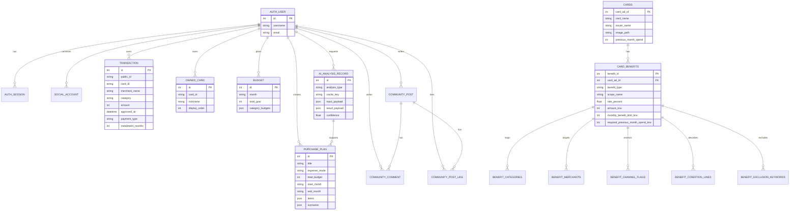

# CARCH 카치

카치는 사용자의 결제내역, 보유 카드, 카드 혜택 조건, 소비계획을 함께 분석해서
“지금 가진 카드 중 무엇을 쓰면 좋은지”와 “새 카드를 발급할 가치가 있는지”를
나누어 안내하는 카드 소비 코치 서비스입니다.

## 빠른 링크

| 구분 | 링크 |
| --- | --- |
| 서비스 웹 | https://carch.vercel.app |
| 서비스 API | https://carch-api.vercel.app |
| 시연/demo | https://carch-demo.vercel.app/demo |
| 개인정보 처리방침 | https://carch.vercel.app/privacy |
| App Store 준비 문서 | [docs/APP_STORE_READINESS.md](docs/APP_STORE_READINESS.md) |
| Supabase/Vercel 배포 문서 | [docs/SUPABASE_VERCEL_DEMO.md](docs/SUPABASE_VERCEL_DEMO.md) |

서비스 채널과 시연 채널은 같은 코드베이스를 사용하지만 환경변수와 DB schema를 분리합니다.
`carch.vercel.app`은 실제 서비스/App Store 기준이고, `carch-demo.vercel.app/demo`는 자동 로그인되는 발표/포트폴리오용 흐름입니다.

## 1. 팀원 정보 및 업무 분담

| 팀원 | 주요 업무 |
| --- | --- |
| 남주현 | 프론트엔드 UI/UX, 카드 메인 화면, 소비계획/분석/카치AI 화면 고도화, 데모 시나리오 검증 |
| 조성익 | 백엔드 API, 데이터 모델링, 카드 혜택 데이터 정제, 추천 로직, GMS AI 연동, 배포 구조 정리 |
| 공통 | 서비스 기획, 테스트, 발표 시나리오, README 및 산출물 정리 |

## 2. 목표 서비스와 실제 구현 정도

### 목표

- 카드별 혜택 조건을 사람이 직접 비교하지 않아도 되도록 자동 분석한다.
- 사용자의 실제 결제내역을 기반으로 보유 카드 사용 전략을 제안한다.
- 소비 패턴상 유의미한 이득이 있을 때만 새 카드 발급 추천을 분리해서 제안한다.
- 예산/지출계획과 카드 추천이 따로 놀지 않도록 하나의 흐름으로 연결한다.
- 생성형 AI는 숫자를 새로 만들지 않고, 규칙 기반 계산 결과를 사용자가 이해하기 쉽게 설명한다.

### 구현 완료

- 이메일/데모 로그인 및 세션 인증
- 카드 목록, 카드 상세, 보유 카드 추가/삭제
- 거래내역 목록, 상세, 직접 입력, 삭제
- 월별 소비 분석, 카테고리/카드별 소비 집계
- 소비계획 화면, 월 예산, 반복 지출 판단, 새 카드 추천 패널
- 보유 카드 사용 추천과 새 카드 발급 추천 분리
- 카치AI 채팅 UI 및 GMS 기반 응답
- 커뮤니티 게시글/댓글/좋아요/신고/숨김
- Supabase 카드 카탈로그 연동 및 Supabase Storage 카드 이미지 연동
- Vercel 배포 준비 설정 파일과 실행 문서
- App Store 제출용 service 채널, iOS Capacitor shell, Keychain 기반 토큰 저장, 계정 삭제, 개인정보 처리방침

> 시연/demo 채널은 `/demo`와 자동 로그인 흐름을 유지합니다. App Store/service 채널은 실제 이메일 가입/로그인, 계정 삭제, 개인정보 처리방침, 커뮤니티 신고/숨김 흐름을 기준으로 검수합니다.

## 3. 기술 스택

| 영역 | 사용 기술 |
| --- | --- |
| Frontend | Vue 3, Vite, Vue Router, lucide-vue-next |
| Backend | Django 5, Django ORM, SQLite/Supabase Postgres 호환 구조 |
| AI | SSAFY GMS OpenAI-compatible API, FastAPI AI proxy 선택 지원 |
| Data | Supabase Postgres, Supabase Storage, 카드 혜택 정규화 테이블 |
| Deployment | Vercel, Supabase schema split, Capacitor iOS shell |

## 4. 데이터베이스 모델링 / ERD

서비스 데이터는 Django 모델을 중심으로 관리하고, 카드 상품/혜택 카탈로그는
Supabase에 정규화된 별도 테이블로 관리합니다.



## 5. 추천 알고리즘 기술 설명

카치의 추천은 생성형 AI가 임의로 만드는 방식이 아니라, 백엔드의 규칙 기반 계산 결과를
먼저 만들고 AI는 그 결과를 자연어로 설명하는 구조입니다.

1. **소비 프로필 생성**
   - 로그인 사용자의 거래내역을 월별, 카테고리별, 카드별로 집계합니다.
   - 이번 달, 지난달, 최근 평균 사용액을 비교해 소비 변화와 주요 카테고리를 계산합니다.
   - 일시 지출과 반복 가능 지출을 분리해서 카드 추천에 반영합니다.

2. **혜택 규칙 매칭**
   - 카드 혜택의 카테고리, 가맹점, 결제 채널, 제외 조건, 전월 실적, 월 한도를 정규화해 비교합니다.
   - 거래 카테고리와 카드 혜택 범위가 맞는지 확인합니다.
   - 할부/무이자 할부처럼 혜택 제외 가능성이 있는 결제 조건은 별도 감점 또는 제외 처리합니다.

3. **보유 카드 사용 추천**
   - 사용자가 이미 가진 카드만 대상으로 현재 지출에 적용 가능한 혜택을 계산합니다.
   - 현재 혜택 가능 카드와 다음 달 실적 준비용 카드를 구분합니다.
   - “지금 바로 혜택”, “실적을 채우면 다음 달 유리”, “혜택 제외 위험” 같은 이유 코드를 함께 제공합니다.

4. **새 카드 발급 추천**
   - 전체 카드 후보를 대상으로 예상 월 혜택을 계산합니다.
   - 전월 실적 조건, 월 한도, 연회비의 월 환산액을 반영합니다.
   - 보유 카드 대비 추가 이득이 있는 후보만 우선순위로 노출합니다.

5. **AI 설명 레이어**
   - 백엔드가 계산한 카드명, 금액, 조건, 추천 사유만 프롬프트에 전달합니다.
   - AI는 없는 혜택, 없는 카드, 임의의 할인율을 만들 수 없도록 프롬프트에서 제한합니다.
   - AI 응답 실패 시에도 규칙 기반 fallback 응답으로 시연이 유지됩니다.

## 6. 핵심 기능

### 카드 홈

- 보유 카드 캐러셀
- 카드별 실적 충족률
- 카드 상세 진입 및 삭제
- 카테고리별 보유 카드 추천
- 최근 거래내역 확인

### 소비 분석

- 월별 총 소비
- 전월/평균 대비 변화
- 카테고리별 소비 비중
- 카드별 사용액
- 예산 사용 추이

### 소비계획

- 이번 달 예산 사용 현황
- 반복 지출 후보 판단
- 지출계획 입력
- 새 카드 추천과 연결

### 추천

- 보유 카드 개선 추천
- 맞춤 카드 발급 추천
- 혜택 조건, 월 한도, 전월 실적 조건 반영
- 추천 결과에 대한 AI 설명

### 카치AI

- 카카오톡형 말풍선 UI
- 보유 카드 개선/맞춤 카드 추천 빠른 질문
- 사용자의 결제내역, 보유 카드, 소비계획 컨텍스트 기반 답변
- 대화 상태 유지 및 관련 화면 이동 지원

### 커뮤니티

- 카드 후기와 혜택 전략 게시글
- 댓글, 좋아요, 저장
- 검색, 나의 글, 저장됨 필터
- 신고/숨김 흐름으로 서비스 채널 운영 리스크 완화

## 7. 생성형 AI 활용 부분

- **거래내역 입력 보정**: 사용자가 자연어로 입력한 결제 내용을 구조화합니다.
- **소비계획 분석**: 큰 지출 계획을 항목/기간/예산으로 정리하고 카드 사용 시나리오를 생성합니다.
- **카드 추천 설명**: 규칙 기반 추천 결과를 사용자가 이해하기 쉬운 문장으로 설명합니다.
- **카치AI 상담**: 최근 결제내역, 보유 카드, 소비계획을 컨텍스트로 받아 짧고 실용적인 답변을 생성합니다.

AI 연동은 `backend/api/ai_prompts.py`, `backend/api/ai_service.py`에 분리되어 있으며,
GMS API 키가 없거나 응답이 실패해도 fallback 응답으로 기본 시연 흐름이 유지됩니다.

## 8. 배포 및 데이터 구조

### 현재 서비스 URL

| 채널 | URL | 용도 |
| --- | --- | --- |
| service web | https://carch.vercel.app | 실제 서비스/App Store 기준 웹 |
| service API | https://carch-api.vercel.app | Django API, service schema 기준 |
| demo web | https://carch-demo.vercel.app/demo | 발표/포트폴리오 시연, 자동 로그인 |
| legacy alias | https://carch-web.vercel.app | 이전 프론트 alias |

체험 계정은 `skawngus / skawngus`입니다. 이 계정은 demo 채널에서만 자동 시연 흐름으로 사용합니다.

### 배포 준비

- Supabase 프로젝트에 카드 카탈로그와 남주현 데모 데이터를 적재했습니다.
- 카드 이미지는 Supabase Storage `card-images` 버킷 기준으로 제공할 수 있습니다.
- Vercel 배포 설정 파일을 `backend/vercel.json`, `frontend/vercel.json`에 추가했습니다.
- Supabase는 하나의 프로젝트 안에서 `catalog`, `demo`, `service` schema를 분리합니다.
- 서비스용 DB에는 공용 카드 카탈로그만 참조하고, 일반 사용자 데이터는 비어 있는 상태에서 시작합니다.
- iOS 앱스토어 배포 준비는 [docs/APP_STORE_READINESS.md](docs/APP_STORE_READINESS.md)에 정리했습니다.
- 자세한 배포 절차는 [docs/SUPABASE_VERCEL_DEMO.md](docs/SUPABASE_VERCEL_DEMO.md)를 참고합니다.

### 채널별 환경 구조

| 항목 | demo | service |
| --- | --- | --- |
| `APP_CHANNEL` | `demo` | `service` |
| `DEMO_FEATURES_ENABLED` | `true` | `false` |
| `DATABASE_SCHEMA` | `demo` | `service` |
| `CARD_CATALOG_SCHEMA` | `catalog` | `catalog` |
| 자동 로그인 | 사용 | 미사용 |
| 초기 데이터 | 남주현 시연 데이터 | 신규 사용자는 빈 상태 |

서비스 채널은 카드 카탈로그만 공용 `catalog` schema에서 읽고, 사용자 데이터는 `service` schema에 따로 저장합니다.

### App Store 준비 상태

- Bundle ID: `com.choim2013.carch`
- App Store Connect 앱: `CARCH`
- App Store 버전: `1.0`
- 연결된 빌드: `3`
- App Store Connect 상태: `PREPARE_FOR_SUBMISSION`
- 제출용 스크린샷: `docs/screenshots/appstore/iphone-6-9/`에 보관하고 App Store Connect에도 업로드
- 남은 제출 전 수동 항목: App Review 연락 담당자 정보, App Privacy 설문

리뷰 계정은 App Store Connect의 App Review Information에만 저장합니다. 공개 README에는 심사용 비밀번호를 커밋하지 않습니다.

## 9. 실행 방법

### Backend

```powershell
cd backend
python -m venv .venv
.\.venv\Scripts\Activate.ps1
pip install -r requirements.txt
Copy-Item .env.example .env
python manage.py migrate
python manage.py seed_demo
python manage.py runserver 127.0.0.1:8000
```

### Frontend

```powershell
cd frontend
npm install
Copy-Item .env.example .env
npm.cmd run dev
```

브라우저에서 아래 주소로 접속합니다.

```txt
http://127.0.0.1:5173
```

### 데모 계정

```txt
id: skawngus
password: skawngus
```

관리자/데모 로그인 흐름에서도 남주현 시나리오가 재현되도록 구성했습니다.

### 검증 명령

```bash
cd backend
.venv/bin/python manage.py test api

cd ../frontend
npm run build
VITE_IOS_API_BASE_URL=https://carch-api.vercel.app npm run ios:sync
```

현재 기준 백엔드 API 테스트 30개, 프론트 프로덕션 빌드, Capacitor iOS sync를 통과했습니다.

## 10. 실행 화면 캡처본

실행 화면 캡처본은 `docs/screenshots/`에 저장합니다.

| 화면 | 파일 |
| --- | --- |
| 카드 홈 | `docs/screenshots/cards.png` |
| 소비 분석 | `docs/screenshots/analytics.png` |
| 소비계획 | `docs/screenshots/budget.png` |
| 카치AI | `docs/screenshots/chat.png` |

App Store 제출용 iPhone 6.7/6.9 스크린샷은 `docs/screenshots/appstore/iphone-6-9/`에 저장합니다.

## 11. 제출 산출물

- `README.md`: 프로젝트 개요, 역할 분담, ERD, 알고리즘, 실행 방법
- 완성된 소스코드: `backend/`, `frontend/`
- 실행 화면 캡처본: `docs/screenshots/`
- 이전 기획/설계 문서:
  - [docs/SERVICE_SPEC.md](docs/SERVICE_SPEC.md)
  - [docs/DATASET_SUMMARY.md](docs/DATASET_SUMMARY.md)
  - [docs/DEMO_RUNBOOK.md](docs/DEMO_RUNBOOK.md)
  - [docs/LOCAL_COLLAB_SETUP.md](docs/LOCAL_COLLAB_SETUP.md)
  - [docs/SUPABASE_VERCEL_DEMO.md](docs/SUPABASE_VERCEL_DEMO.md)

## 12. 보안 및 제출 주의사항

아래 파일과 값은 커밋하지 않습니다.

- `.env`
- `backend/db.sqlite3`
- Supabase secret key
- GMS API key
- OAuth client secret
- 원본 카드 데이터 번들 전체

공유 저장소에는 실행 가능한 코드와 문서, 공개 가능한 정적 이미지와 예시 설정만 포함합니다.
